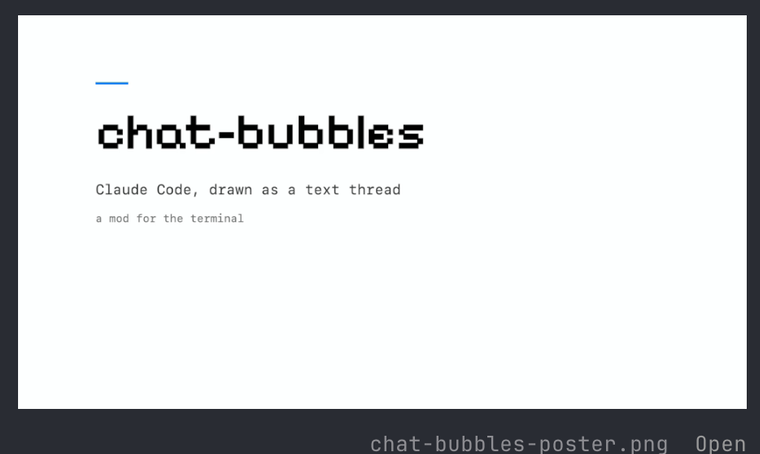

# claude-imessage-mod

A Claude Code mod that makes your terminal chat look and feel like iMessage. A mod changes how Claude Code looks or behaves. This one is called `chat-bubbles` when you install it.

Your Claude Code chat becomes a text thread:

- Your messages sit in blue bubbles on the right and Claude's replies in gray bubbles on the left. While Claude works, a gray bubble with three dots shows it is typing.
- Hold a bubble to tapback it (♥ 👍 👎 HA !! ?), reply to it in a thread, or copy it.
- Claude tapbacks you back: an emoji on your message for what it is doing with it. Rest the pointer on it to read a few words more.
- Pictures show as photos: ones you paste or drag in, pictures Claude reads, and pictures Claude sends you. In Ghostty, kitty and iTerm2 they are real pixels.
- `Delivered` under your newest message turns into `Read` and the time once Claude starts answering.

The steps Claude takes stay out of sight, so you read only the conversation.

[](pictures/chat-bubbles-demo.mp4)

The clip shows the `round` style, which needs a small font. A new install starts with square `block` bubbles. See [Round bubbles need a small font](#round-bubbles-need-a-small-font).

What you see:

| In the chat | What you see |
| --- | --- |
| your message | a blue bubble on the right with white text. Messages you send through Remote Control (a phone or the web) or as a Slack ping look the same. |
| Claude's reply | a gray bubble on the left, in Claude Code's light or dark theme |
| while Claude works | a gray bubble with three dots |
| under the message box | the keyboard tips are hidden. A count such as `1 shell` stays |
| tool steps | hidden |
| a failed or stopped step | one small red line, such as `Read failed`, `Bash stopped` or `1 of 3 steps failed`. The error text stays out of the chat. |
| a table in a reply | the bubble grows as wide as the table needs, up to the whole window. A table too wide for any bubble keeps Claude Code's own look, so it stays readable. |
| a code block in a reply | the bubble grows to fit it, up to 85% of the window width |
| updates from background helpers | one gray line in the middle that says who sent it, such as `A background task finished` or `Another Claude session sent an update`. The message itself is not shown. |
| holding the mouse down on a bubble | the tapback bar (♥ 👍 👎 HA !! ?) with Reply and Copy, as on a phone. See [Tapbacks, replies and Read](#tapbacks-replies-and-read) |
| Claude working on your message | Claude tapbacks your bubble with an emoji for what it is doing. Rest the pointer on it to read a few words more |
| a picture you paste or name by its path | a photo above your words. See [Photos](#photos) |

Above your first message sit Claude's name and the time. The time shows again after a gap of 15 minutes or more. In the full-screen chat view, `Delivered` shows under your newest message.

The mod changes only what is drawn. What the model reads and what is saved stay the same.

## Install

At the prompt of a Claude Code terminal session:

```
/plugin install chat-bubbles --marketplace ussumant/claude-imessage-mod
```

Answer `y` to add the marketplace, then pick a scope with Enter.

From a shell:

```
claude plugin install chat-bubbles --marketplace ussumant/claude-imessage-mod
```

In the desktop app, where `/plugin` does not run: click + next to the prompt box, then Plugins, Add marketplace with `ussumant/claude-imessage-mod`, then Add plugin. The bubbles are built for the terminal. Outside the terminal the chat is left alone, and the rest is untested there.

## Tapbacks, replies and Read

These work in the full-screen chat view (the `tui: fullscreen` setting), in the `block` and `round` styles. On the normal scrolling screen, and in `pill` and `tail`, bubbles draw as before.

- Hold the mouse button down on any bubble for about half a second. The bubble shades a little while you hold, then the tapback bar unfurls above it, with Reply and Copy under it. Slide onto a tapback and let go, or click one. Picking the same one again takes it off. A click on any bubble, or 15 seconds, closes the bar.
- A tapback on one of Claude's replies reaches Claude with your next message. It never starts a turn by itself.
- Reply puts "Replying to Claude: …" above the message box (✕ cancels it). Your message then shows as a thread: a faded copy of the original, a line running down into your reply, and Claude's answer hooked onto the same line. Claude is told which message you meant. "1 Reply" shows under the original.
- Copy puts the whole message on the clipboard. The bubble catches the press, so dragging to select text inside a bubble no longer works there. Copy, or `/bubbles off` for a moment, stands in for it.
- Claude gets a `react` tool and tapbacks your newest message, first thing when its answer will take a while. The emoji says what it is doing with your message: ✅ for a decision it takes on, 🤔 for a question it is thinking through, or one for the work itself (🐛 a bug, 🧪 tests, 📸 pictures). Rest the pointer on Claude's badge to read a few words on what it is doing. They stay after Claude is done. Some messages get only a tapback back.
- If Claude has not tapbacked your message 4 seconds into a long answer, the mod puts 🤔 on it, with "thinking it through" under the pointer. Claude's own tapback replaces it.
- `Delivered` under your newest message turns into `Read` and the time once Claude starts answering.

The typing dots pulse in a wave.

## Photos

- A picture you paste shows as a photo above your words. So does a picture file you name by its path or drag in from Finder; the path is taken out of your words. The `[Image #1]` mark a paste leaves is dropped.
- A picture Claude reads, such as a screenshot, shows on Claude's side, captioned "Claude looked at <file>".
- Claude gets a `send_image` tool to send you a picture file from your Mac, with an optional caption.
- Open under a photo shows the full-size file in Preview.



In Ghostty, kitty and iTerm2 3.5 or later (iTerm2 in the full-screen view only), photos are real pixels: Claude Code draws pictures there, and the mod hands it a PNG up to 1000 px on its longest side. Everywhere else, Cursor, VS Code, Terminal.app and Warp among them, and inside tmux, photos are drawn in cells, two pixels to a cell. They show in any terminal that way, but look rough. Either way a photo takes up to 56 by 20 cells.

The mod checks which terminal it is in when the chat starts. If it guesses pixels and Claude Code shows the photo's caption instead, the mod notices once and switches that chat to cells.

Photos are made with `sips`, so they need macOS. The files are kept in `/tmp/chat-bubbles-pictures`.

## Round bubbles need a small font

A terminal draws every shape with a font. Normal fonts have no round bubble corners or tails. So the mod comes with a small font, Bubble Caps. Its bubble corners, tails, typing dots and Claude's round avatar sit in a private range of characters that normal text never uses. It also holds a few standard block characters. You list it after your own font, so your font still draws all your text.

Without the font, those characters show as empty boxes, or in Ghostty as garbled bubble edges. That is why a new install starts with `block`: square bubbles made of filled lines, with no font needed. `pill` and `tail` need no extra font either. They use half-block characters, and some terminals, Cursor's among them, draw a thin seam in those.

To use `round`:

1. On macOS, double-click [assets/BubbleCaps-Regular.ttf](assets/BubbleCaps-Regular.ttf), then click Install Font.
2. In VS Code or Cursor, set the terminal font in your settings, with your own font first:

   ```json
   "terminal.integrated.fontFamily": "'Your Font', 'Bubble Caps'"
   ```

   In another terminal, add Bubble Caps to its font list after your main font.
3. Close the terminal and open a new one.
4. Run `/bubbles style round`.

`round` works only in the full-screen chat view (the `tui: fullscreen` setting). On the normal scrolling screen a saved `round` draws `block`. If the bubbles still come out square, start Claude Code with `CLAUDE_CODE_NO_FLICKER=1 claude`, which forces the full-screen view. To go back to bubbles that need no font, run `/bubbles style block`.

## Commands

| Command | What it does |
| --- | --- |
| `/bubbles` | shows the current settings |
| `/bubbles on` and `/bubbles off` | turns the mod on or off in the chat you type it in. Every new chat starts on |
| `/bubbles detail on` and `/bubbles detail off` | shows or hides the tool steps and status lines |
| `/bubbles style block` | picks the bubble shape: `block`, `pill`, `tail` or `round` |
| `/bubbles style` | lists the shapes |
| `/bubbles tail on` and `/bubbles tail off` | shows or hides the tails in `round` |

Style, detail and tail are kept between sessions. On and off apply to the chat you type them in.

## See the hidden steps

Press Ctrl+O to see the full transcript, steps included. To show the steps in the chat itself, run `/bubbles detail on`. `/bubbles detail off` hides them again.

## Not checked yet

- Checked in Cursor's built-in terminal on macOS, with GPU drawing off and the full-screen chat view. In Ghostty 1.3.1 only a photo named by its path is checked, drawn as real pixels. Other terminals, GPU drawing on, Windows, Linux and the desktop app are not checked. Photos as real pixels are not checked in kitty or iTerm2, and `round` with Bubble Caps is not checked in Ghostty.
- Claude's answer hooking onto a thread's line is checked in tests, not yet in a live chat.
- `round` on the normal scrolling screen. There a saved `round` draws `block`.
- Some messages keep Claude Code's own look: a message from outside the chat whose sender the mod cannot name, and a channel message that holds tags.

Known rough edges:

- In current VS Code (1.147) with GPU drawing off, `round` bubbles cover the lower half of each bubble's last line of text. This was seen in VS Code's browser build with both 0.4.14 and 0.5.7. VS Code 1.128 draws them cleanly. Cursor has not been checked for this.

- In `round`, a one-line message with non-Latin text or emoji draws two rows tall.
- A line with some emoji, such as a check mark, can push the right edge of its bubble one cell out.
- A table with a line of plain text right under it, with no blank line between, keeps the 85% bubble and may wrap.
- A table cell that holds code with bold marks or a link inside it can push the table a few cells past its bubble.
- While the band above the prompt is collapsed, its one-line reminder is hidden. A survey there still shows.

Not affiliated with Apple or Anthropic. iMessage is a trademark of Apple Inc.

## License

MIT
