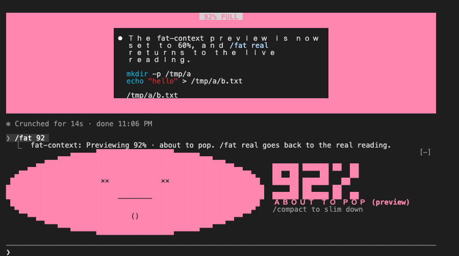

# awesomeclaudemods

Mods for Claude Code. A mod changes how Claude Code looks or behaves.

## fat-context

Your session gets fat as its context window fills up. A full context is slow and expensive, and this makes you feel it before you check a number.



What changes as the context fills:

| Context | Name | What you see |
| --- | --- | --- |
| under 30% | lean | a tiny creature above the prompt, nothing else |
| 30 to 49% | filling out | a solid bar beside each message |
| 50 to 69% | chubby | a solid ring around each message, a rounder creature |
| 70 to 84% | stuffed | thick walls, your own messages in double-width letters, the percent in giant digits |
| 85% and up | about to pop | walls take half the screen, every word is double width, the creature takes 14 rows |

After `/compact` or `/clear` it slims back down.

Code blocks, inline code, paths and links are never redrawn. The mod changes only what is drawn. What the model reads and what is saved stay the same.

### Install

At the prompt of a Claude Code terminal session:

```
/plugin install fat-context --marketplace ussumant/awesomeclaudemods
```

Answer `y` to add the marketplace, then pick a scope with Enter.

From a shell:

```
claude plugin install fat-context --marketplace ussumant/awesomeclaudemods
```

In the desktop app, where `/plugin` does not run: click + next to the prompt box, then Plugins, Add marketplace with `ussumant/awesomeclaudemods`, then Add plugin. The fat look is drawn in the terminal; other surfaces show the creature only.

### Commands

| Command | What it does |
| --- | --- |
| `/fat` | shows the percent, the name and the look |
| `/fat 92` | previews any percent from 0 to 100 |
| `/fat real` | goes back to the real reading |
| `/fat look frames` | walls only (also `belly`, `letters`, `all`) |
| `/fat off` and `/fat on` | hides or shows everything |

### Not checked yet

- Light terminal themes. The mod uses the theme's own colors, but it has only been looked at on a dark one.
- In a window shorter than about 45 rows the biggest creature loses a couple of rows.

## License

MIT
