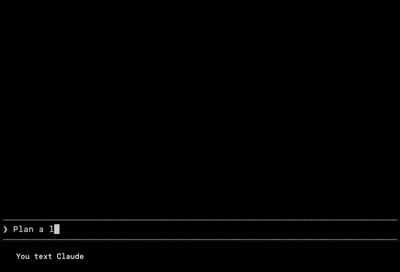

# awesomeclaudemods

Mods for Claude Code. A mod changes how Claude Code looks or behaves.

## chat-bubbles

Your Claude Code chat looks like a text thread. Your messages sit in blue bubbles on the right. Claude's replies sit in gray bubbles on the left. While Claude works, a gray bubble with three dots shows it is typing. The steps Claude takes stay out of sight, so you read only the conversation.

[](pictures/chat-bubbles-demo.mp4)

The clip shows the `round` style, which needs a small font. A new install starts with square `block` bubbles. See [Round bubbles need a small font](#round-bubbles-need-a-small-font).

What you see:

| In the chat | What you see |
| --- | --- |
| your message | a blue bubble on the right with white text. Messages you send through Remote Control (a phone or the web) or as a Slack ping look the same. |
| Claude's reply | a gray bubble on the left, in Claude Code's light or dark theme |
| while Claude works | a gray bubble with three dots |
| under the message box | the keyboard tips are hidden. A count such as `1 shell` stays |
| tool steps | hidden |
| a failed or stopped step | one small red line, such as `Read failed`, `Bash stopped` or `1 of 3 steps failed`. The error text stays out of the chat. |
| a table in a reply | the bubble grows as wide as the table needs, up to the whole window. A table too wide for any bubble keeps Claude Code's own look, so it stays readable. |
| a code block in a reply | the bubble grows to fit it, up to 85% of the window width |
| updates from background helpers | one gray line in the middle that says who sent it, such as `A background task finished` or `Another Claude session sent an update`. The message itself is not shown. |

Above your first message sit Claude's name and the time. The time shows again after a gap of 15 minutes or more. In the full-screen chat view, `Delivered` shows under your newest message.

The mod changes only what is drawn. What the model reads and what is saved stay the same.

### Install

At the prompt of a Claude Code terminal session:

```
/plugin install chat-bubbles --marketplace ussumant/awesomeclaudemods
```

Answer `y` to add the marketplace, then pick a scope with Enter.

From a shell:

```
claude plugin install chat-bubbles --marketplace ussumant/awesomeclaudemods
```

In the desktop app, where `/plugin` does not run: click + next to the prompt box, then Plugins, Add marketplace with `ussumant/awesomeclaudemods`, then Add plugin. The bubbles are built for the terminal. Outside the terminal the chat is left alone, and the rest is untested there.

### Round bubbles need a small font

A terminal draws every shape with a font. Normal fonts have no round bubble corners or tails. So the mod comes with a small font, Bubble Caps. Its bubble corners, tails, typing dots and Claude's round avatar sit in a private range of characters that normal text never uses. It also holds a few standard block characters. You list it after your own font, so your font still draws all your text.

Without the font, those characters show as empty boxes. That is why a new install starts with `block`: square bubbles made of filled lines, with no font needed. `pill` and `tail` need no extra font either. They use half-block characters, and some terminals, Cursor's among them, draw a thin seam in those.

To use `round`:

1. On macOS, double-click [chat-bubbles/assets/BubbleCaps-Regular.ttf](chat-bubbles/assets/BubbleCaps-Regular.ttf), then click Install Font.
2. In VS Code or Cursor, set the terminal font in your settings, with your own font first:

   ```json
   "terminal.integrated.fontFamily": "'Your Font', 'Bubble Caps'"
   ```

   In another terminal, add Bubble Caps to its font list after your main font.
3. Close the terminal and open a new one.
4. Run `/bubbles style round`.

`round` works only in the full-screen chat view (the `tui: fullscreen` setting). On the normal scrolling screen a saved `round` draws `block`. If the bubbles still come out square, start Claude Code with `CLAUDE_CODE_NO_FLICKER=1 claude`, which forces the full-screen view. To go back to bubbles that need no font, run `/bubbles style block`.

### Commands

| Command | What it does |
| --- | --- |
| `/bubbles` | shows the current settings |
| `/bubbles on` and `/bubbles off` | turns the mod on or off in the chat you type it in. Every new chat starts on |
| `/bubbles detail on` and `/bubbles detail off` | shows or hides the tool steps and status lines |
| `/bubbles style block` | picks the bubble shape: `block`, `pill`, `tail` or `round` |
| `/bubbles style` | lists the shapes |
| `/bubbles tail on` and `/bubbles tail off` | shows or hides the tails in `round` |

Style, detail and tail are kept between sessions. On and off apply to the chat you type them in.

### See the hidden steps

Press Ctrl+O to see the full transcript, steps included. To show the steps in the chat itself, run `/bubbles detail on`. `/bubbles detail off` hides them again.

### Not checked yet

- Checked only in Cursor's built-in terminal on macOS, with GPU drawing off and the full-screen chat view. Other terminals, GPU drawing on, Windows, Linux and the desktop app are not checked.
- `round` on the normal scrolling screen. There a saved `round` draws `block`.
- Some messages keep Claude Code's own look: a message from outside the chat whose sender the mod cannot name, and a channel message that holds tags.

Known rough edges:

- In `round`, a one-line message with non-Latin text or emoji draws two rows tall.
- A line with some emoji, such as a check mark, can push the right edge of its bubble one cell out.
- A table with a line of plain text right under it, with no blank line between, keeps the 85% bubble and may wrap.
- A table cell that holds code with bold marks or a link inside it can push the table a few cells past its bubble.
- While the band above the prompt is collapsed, its one-line reminder is hidden. A survey there still shows.

Not affiliated with Apple or Anthropic. iMessage is a trademark of Apple Inc.

## License

MIT
